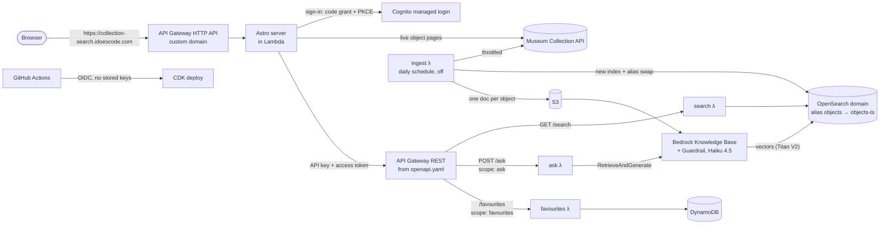

# Collection Search Demo

A learning project: hands-on with Amazon Bedrock, Amazon OpenSearch Service and Amazon Cognito, using a public museum collection.

It indexes a sample of the National Museum of Australia's public collection (about 3,750 objects) for keyword search with facets. It also offers **Ask the collection**: questions answered from the collection records with retrieval-augmented generation, through a Bedrock Knowledge Base and a Guardrail, with a citation for every claim.

**Live:** https://collection-search.idoescode.com, while the stacks are deployed. They're torn down between demos to save cost, and rebuilt from code.

> **Screen recording:** _to be added._

## What it does

- **Search** (`/`): keyword search with synonyms (`woomera` finds spear-throwers), stemming, highlighting and facets for type, place and decade. Results come from our own OpenSearch index.
- **Object pages** (`/object/<id>`): read live from the Museum's Collection API, with images hotlinked from the Museum, their rights statements, and a link back to the record.
- **Ask the collection** (`/ask`, sign-in required): Claude Haiku 4.5 answers from the six most relevant records and cites each one. It says so when the collection doesn't cover a question. A Guardrail blocks valuation requests, prompt attacks and harmful content, masks personal details, and checks answers are grounded in the records. Requests for secret or sacred cultural knowledge are detected and counted for review rather than blocked, because blocking them refused everyday questions about Aboriginal objects ([ADR 7](docs/adr/0007-guardrail-for-ask.md)).
- **Favourites** (`/favourites`, sign-in required): save objects per user.

## Architecture



Everything runs in `ap-southeast-2` (Sydney). Generation uses the `au.` cross-region inference profile, which stays within Sydney and Melbourne. Embeddings use Titan Text Embeddings V2 in Sydney.

| Stack                     | What it holds                                                                                                |
| ------------------------- | ------------------------------------------------------------------------------------------------------------ |
| `CollectionSearch-Search` | OpenSearch domain (fine-grained access control), its bootstrap, ingest Lambda and schedule, documents bucket |
| `CollectionSearch-Ai`     | Knowledge Base and data source, Guardrail, Bedrock invocation logging                                        |
| `CollectionSearch-Auth`   | Cognito user pool, managed login, resource server with `ask` and `favourites` scopes, web and CLI clients    |
| `CollectionSearch-Api`    | API Gateway (usage plan, API key, throttling, Cognito authoriser), Lambdas, DynamoDB, alarms, dashboard      |
| `CollectionSearch-Web`    | The Astro server in Lambda (Lambda Web Adapter), behind an HTTP API on the custom domain                     |
| `CollectionSearch-Domain` | The site's certificate and custom domain name (kept by teardown, so the DNS records stay valid)              |
| `CollectionSearch-Ci`     | GitHub OIDC provider and the deploy role (deployed by hand, kept by teardown)                                |

## What's real and what isn't

**Real and deployed:** every piece in the diagram. The verification is in the ADRs and the evaluation results, for example 401 and 403 responses from the gateway, a zero-downtime alias swap under load, Guardrail blocks, and alarm emails.

**Not production-ready, on purpose:**

- There's one OpenSearch node with no replicas, and everything is deleted on teardown (`RemovalPolicy.DESTROY`).
- There's no MFA.
- The data is a sample of about 3,750 of the Museum's 97,000 objects.

## Running it

### Prerequisites

- An AWS account with the CDK bootstrapped in `ap-southeast-2` (`cdk bootstrap`).
- Bedrock access in Sydney to Claude Haiku 4.5 and Claude Sonnet 4.6 (Sonnet is only used as the eval's judge) and to Titan Text Embeddings V2.
- Node 24 and pnpm 10.
- Credentials through a named profile: `export AWS_PROFILE=<your-profile>`. Nothing in the code names an account or profile.

### Deploy from scratch (about 40 minutes, mostly creating the domain)

```sh
pnpm install

# Where alarm emails go. Kept outside the code. Confirm the subscription email AWS sends you.
aws ssm put-parameter --name /collection-search/alarm-email --type String --value you@example.org

pnpm cdk:deploy --all     # every stack except Ci (see below); the Astro build runs during synth
pnpm ingest               # fetch from the Collection API, build the index, write KB documents (~1 min)
pnpm kb:sync              # embed the documents into the Knowledge Base (~5 min)
pnpm user:create you@example.org   # self sign-up is off; Cognito emails a temporary password
pnpm web                  # optional: the same site locally, at http://localhost:4321
```

**The site's domain** is `WEB_DOMAIN` in [`functions/lib/auth/constants.ts`](functions/lib/auth/constants.ts): change it to a name you control. DNS can be hosted anywhere. The first deploy needs two records, made by hand:

1. While `CollectionSearch-Domain` waits for its certificate, add the validation CNAME that ACM asks for (`aws acm describe-certificate --certificate-arn … --query 'Certificate.DomainValidationOptions[0].ResourceRecord'`). The deploy carries on once ACM issues the certificate, usually within minutes.
2. Point a CNAME for the domain at the `RegionalDomainName` output of `CollectionSearch-Domain`.

Teardown keeps that stack, so both records stay valid and a rebuild needs no DNS changes.

An optional Collection API key raises the rate limits: set `NMA_API_KEY` for `pnpm fetch-sample`. The ingest works without one.

**Deploys from GitHub Actions** need the `Ci` stack once. Pass it the subject prefix GitHub uses for your repository's OIDC tokens. Then set the `DeployRoleArn` output as the `AWS_DEPLOY_ROLE_ARN` repository variable:

```sh
pnpm cdk:deploy CollectionSearch-Ci --exclusively -c githubSubjectPrefix="$(
  gh api repos/OWNER/NAME/actions/oidc/customization/sub --jq .sub_claim_prefix)"
```

### Useful commands

| Command                                                   | What it does                                                                   |
| --------------------------------------------------------- | ------------------------------------------------------------------------------ |
| `pnpm call GET '/search?q=boomerang'`                     | Calls the API with the key and, when needed, a token (opens a browser sign-in) |
| `pnpm ask "What did people use to start fires?"`          | Asks the collection from the terminal                                          |
| `pnpm eval`                                               | Runs the evaluation set (see [`evals/`](evals/README.md))                      |
| `pnpm os GET '/_cat/indices?v'`                           | One signed request to OpenSearch, as the admin role                            |
| `pnpm kb:retrieve "…"`, `pnpm guardrail:test`             | Try retrieval or the Guardrail on their own                                    |
| `pnpm status` (`--cost` adds spend to date, $0.01 a call) | Deployed stacks and anything billed by the hour                                |
| `pnpm test`, `pnpm typecheck`, `pnpm lint`                | The same checks CI runs                                                        |

### Tear down

```sh
pnpm teardown --dry-run   # what would be deleted
pnpm teardown             # asks you to type the project name
```

This deletes every stack except `Ci` and `Domain`, which are free to keep. It then removes leftover log groups and switches off Bedrock invocation logging if this project switched it on. It finishes with `pnpm status`, which should show nothing billed by the hour.

## Cost

USD in Sydney, from AWS list prices. These are estimates, not a bill.

| What                                       | Cost                                      |
| ------------------------------------------ | ----------------------------------------- |
| OpenSearch: 1 × `m7g.medium.search`, 10 GB | **about $2.09 a day (about $63 a month)** |
| Bedrock embeddings, one full KB sync       | about $0.03                               |
| Ask: one question (Haiku 4.5 + Guardrail)  | a fraction of a cent                      |
| Two secrets, 13 alarms                     | about $2.10 a month                       |
| Cognito Essentials                         | free tier (10,000 monthly active users)   |
| API Gateway, Lambda, DynamoDB, S3, logs    | cents at demo traffic                     |
| Site certificate and custom domain         | free                                      |

The domain is the only hourly cost, so the plan is to tear down between demos and rebuild from code. `pnpm status` lists anything billed by the hour in the region.

## Decisions

Each significant choice has an architecture decision record, with the options considered and how it was verified:

1. [Record architecture decisions](docs/adr/0001-record-architecture-decisions.md)
2. [One managed OpenSearch domain for keyword search and Knowledge Base vectors](docs/adr/0002-managed-opensearch-domain.md)
3. [Public domain endpoint with fine-grained access control, not a VPC](docs/adr/0003-public-endpoint-with-fine-grained-access-control.md)
4. [Versioned indices behind an alias, with search-time synonyms](docs/adr/0004-index-aliases-and-search-time-synonyms.md)
5. [Collection data: what we store, how we stay current, how we credit the Museum](docs/adr/0005-collection-data-use-and-refresh.md)
6. [Knowledge Base vectors on the existing domain, one chunk per object](docs/adr/0006-knowledge-base-on-the-opensearch-domain.md)
7. [A Guardrail for Ask, tuned against over-blocking](docs/adr/0007-guardrail-for-ask.md)
8. [Evaluating Ask: eval set, LLM judge, calibrated grounding, query expansion](docs/adr/0008-evaluating-ask.md)
9. [Sign-in with Cognito: managed login, PKCE, scopes at the gateway](docs/adr/0009-sign-in-with-cognito.md)
10. [CI on every change, keyless deploys through GitHub OIDC](docs/adr/0010-ci-and-keyless-deploys.md)
11. [Spec-first API: one OpenAPI file builds the gateway and types the code](docs/adr/0011-spec-first-openapi.md)
12. [Data residency: everything in Sydney, generation within Australia, enforced by IAM](docs/adr/0012-data-residency.md)
13. [Hosting the web front end: Lambda behind an HTTP API on a custom domain](docs/adr/0013-hosting-the-web-front-end.md)

## Evaluation

[`evals/`](evals/README.md) has 25 attributed questions: factual, known retrieval traps, out-of-scope and should-be-blocked. Each run scores:

- retrieval recall and hit rate in the top six;
- whether the expected behaviour happened (an answer, "not covered", or a block);
- faithfulness and helpfulness, scored by Claude Sonnet 4.6 as the judge.

The latest run ([expanded-v2](evals/results/2026-11-11-expanded-v2.md)):

| Expectation met | Recall@6 | Hit@6 | Faithfulness | Helpfulness |
| --------------- | -------- | ----- | ------------ | ----------- |
| 96%             | 93%      | 100%  | 4.81 / 5     | 4.33 / 5    |

## Known limitations

- **Object pages depend on the Museum's API being up.** If it's down, or slower than 5 seconds, the page shows a clear error rather than the record. Next steps:
  - serve the cached copy with its "retrieved at" time;
  - fall back to our indexed copy of the record.
- **Cold starts:** the first page after an idle spell takes about 1.5 seconds longer.
- **Images:** the Museum's terms allow only API image URLs, hotlinked. Some records have images on the Museum's website that the API doesn't include. In our sample, none of the 39 spear-throwers, boomerangs, shields and coolamons have API images, against 56% of all sampled objects. Those pages link to the record instead, and the app doesn't scrape images.
- **Retrieval still misses some wordings.** For example, "woomera" isn't linked to "spear-thrower" in the embeddings. Query expansion with the search synonyms fixed most cases (ADR 8). Hybrid keyword and vector retrieval would be next.
- **Sign-out isn't instant revocation.** Access tokens stay valid until they expire, up to one hour (ADR 9).
- **The trust boundary for deploys is `main`.** CloudFormation's execution role is admin. ADR 10 lists the hardening steps: branch protection, an environment approval, a narrower bootstrap policy, and blocking network egress on runners.
- **No MFA, one OpenSearch node, sample data** (see above).

## Built with Claude Code

This was built in small, reviewed steps with [Claude Code](https://claude.com/claude-code) as a pair programmer. Each step was planned, explained, verified against the real AWS resources, and committed with its ADR. The design decisions, the review and the verification were mine, and the ADRs record where things went wrong and how they were fixed.

## Repository layout

| Path           | What it holds                                                                 |
| -------------- | ----------------------------------------------------------------------------- |
| `openapi.yaml` | The API contract. Lambda and web client types are generated from it           |
| `infra/`       | AWS CDK app (TypeScript)                                                      |
| `functions/`   | Lambda handlers, and shared code (Museum client, query builder, auth helpers) |
| `web/`         | Astro server-rendered front end                                               |
| `search/`      | Index mappings, analysers and synonyms                                        |
| `evals/`       | Evaluation set and results                                                    |
| `scripts/`     | Ingest, KB sync, status, teardown, API and OpenSearch helpers                 |
| `docs/adr/`    | Architecture decision records                                                 |
| `.github/`     | CI, the manual deploy workflow, Dependabot                                    |

## Data, attribution and affiliation

Collection Search Demo was developed using the National Museum of Australia's Collection API.

- The collection metadata is licensed [CC BY-NC 4.0](https://creativecommons.org/licenses/by-nc/4.0/) by the National Museum of Australia, so it may be used for non-commercial purposes only. Every record in the app links back to its page on the Museum's website, and object pages show when the record was read from the API.
- Images are shown only from the URLs the API provides, hotlinked from the Museum's servers, with their rights statements.
- This repository holds no Museum data dumps: the ingest fetches data from the API at run time. The evaluation set quotes a few object IDs and titles, with attribution.
- Aboriginal and Torres Strait Islander people are advised that the app may contain images, voices and names of people who have died.
- This project is an independent learning exercise. It is **not affiliated with, endorsed by or connected to the National Museum of Australia**.

## Licence

The code is licensed under MIT (see [LICENSE](LICENSE)). The licence doesn't cover the Museum's data, which stays under the Museum's own terms.
